# 🎬 Awesome Visual Effects & Motion Graphics

<p align="center">
  
</p>

<p align="center">
  <a href="https://github.com/ishandutta2007/Awesome-Awesome-Awesome"></a>
  <a href="https://discord.gg/jc4xtF58Ve"></a>
  <a href="https://github.com/ishandutta2007/Awesome-Visual-Effects-Motion-Graphics/stargazers"></a>
  <a href="https://github.com/ishandutta2007/Awesome-Visual-Effects-Motion-Graphics/network/members"></a>
  <a href="https://github.com/ishandutta2007/Awesome-Visual-Effects-Motion-Graphics/blob/main/LICENSE"></a>
  <a href="https://github.com/ishandutta2007/Awesome-Visual-Effects-Motion-Graphics/pulls"></a>
  <a href="https://github.com/ishandutta2007"></a>
</p>

---

## 🌟 Top Visual Effects & Motion Graphics Ecosystem

> **A rigorously curated directory of SaaS platforms, commercial suites, and open-source GitHub projects for visual effects (VFX), node-based compositing, procedural motion design, and subscription-free post-production pipelines.**

Visual effects (VFX) and motion design represent the digital foundation of modern cinema, episodic television, game cinematics, commercial advertising, and interactive media. This index tracks category-defining proprietary software alongside community-driven open-source alternatives covering node graph compositing, keying, rotoscoping, matchmoving, 3D camera tracking, procedural particle simulations, and dynamic typography.

---

## 📑 Table of Contents

- [📊 Sector Overview & Market Dynamics](#-sector-overview--market-dynamics)
- [💼 Commercial & SaaS Platforms](#-commercial--saas-platforms)
- [🔓 Open-Source GitHub Projects](#-open-source-github-projects)
- [🛠️ VFX & Pipeline Reference Architecture](#️-vfx--pipeline-reference-architecture)
- [🤝 How to Contribute](#-how-to-contribute)
- [⭐ Star History](#-star-history)
- [💖 Support & Sponsoring](#-support--sponsoring)
- [⚖️ Disclaimer & Licensing](#️-disclaimer--licensing)

---

## 📊 Sector Overview & Market Dynamics

The global visual effects (VFX) and motion graphics software industry was estimated at **$11.2 billion in 2024** and is projected to surpass **$21.5 billion by 2032**, demonstrating an annual compound growth rate (CAGR) of **8.6%**, propelled by exponential streaming content production, virtual production (LED volumes), real-time game engines, and procedural AI automation.

The sector operates as a **bimodal, highly concentrated oligopoly** at the top tier: **Adobe Inc.** maintains dominant market share across commercial motion graphics and broadcast design with After Effects, while **Autodesk** and **Foundry (Roper Technologies)** control the high-end feature film and episodic pipeline via Flame and Nuke. Simultaneously, the market experiences **rapid grassroots fragmentation** at the indie and technical artist tier, driven by **Blender's** expansion across full 3D/2D production, the emergence of Rust-native compositors like **EffectCraft**, programmatic code-first frameworks like **Remotion**, and Academy Software Foundation standards (**OCIO**, **OIIO**, **OpenVDB**) breaking proprietary vendor lock-in.

---

## 💼 Commercial & SaaS Platforms

The table below catalogs premier commercial suites and SaaS motion platforms, **sorted in descending order by company scale (valuation / market capitalization / revenue)**.

| 🖥️ Platform / Tool | 🎯 Focus & Key Capabilities | 🏢 Company Scale / Valuation | 💳 Starting Tier Pricing | 🎁 Free Tier / Free Trial Limits |
| :--- | :--- | :--- | :--- | :--- |
| **[Adobe After Effects](https://www.adobe.com/products/aftereffects.html)** | Industry-standard layer-based motion graphics, visual effects, character rigging, and 2.5D/3D compositing with extensive plugin ecosystems. | **~$175 Billion** Market Cap (Adobe Inc., NASDAQ: ADBE; ~$21.4B FY24 Revenue) | **$22.99/mo** (Annual plan, paid monthly) or $34.49/mo (Month-to-month); $239.88/yr prepaid | **7-day free trial** with complete access to all native features, expressions, and 100GB cloud storage; auto-renews to paid tier unless canceled. |
| **[Autodesk Flame](https://www.autodesk.com/products/flame/overview)** | High-end episodic and commercial finishing suite integrating 3D visual effects, timeline conform, color grading, and node-based compositing. | **~$62 Billion** Market Cap (Autodesk, Inc., NASDAQ: ADSK; ~$5.5B FY24 Revenue) | **$580/mo** (Monthly contract) or **$4,635/yr** (Annual upfront license; saves ~33%) | **30-day free trial** with full software capabilities and no resolution caps; free 1-year renewable license for verified students & educators. |
| **[Foundry Nuke](https://www.foundry.com/products/nuke-family/nuke)** | Academy Award-winning node-based digital compositing standard for feature film VFX, deep-image compositing, multi-channel EXR workflows, and stereoscopy. | **~$60 Billion** Parent Market Cap (Roper Technologies, NYSE: ROP; Foundry division ~$100M+ rev) | **$499/yr** for Nuke Indie (solo artists earning <$100k/yr); **$3,469/yr** for Nuke Commercial subscription | **Nuke Non-Commercial is 100% free forever** for learning/personal work (capped at 1080p render, disabled MPEG codecs & 3rd-party OFX plugins); 30-day full commercial trial. |
| **[Maxon One (Cinema 4D & Red Giant)](https://www.maxon.net/)** | Comprehensive suite uniting Cinema 4D 3D motion design, Red Giant visual effects (Trapcode Particular, Magic Bullet, VFX Suite), and Redshift GPU rendering. | **~$13 Billion** Market Cap (Nemetschek Group, ETR: NEM; ~€850M+ Revenue) | **$49/mo** (Red Giant annual) or **$99.91/mo** ($1,199/yr prepaid) for complete Maxon One suite | **14-day free trial** of the entire Maxon One collection with full GPU rendering and plugin feature access; requires Maxon App registration. |
| **[Blackmagic Fusion Studio](https://www.blackmagicdesign.com/products/fusion/)** | High-performance node-based 3D compositing, spatial optical flow, VR toolsets, motion tracking, and volumetric particle generation. | **~$2.5 Billion** Est. Valuation (Blackmagic Design Pty Ltd; ~$750M+ annual revenue) | **$295 one-time** perpetual license (includes DaVinci Resolve Studio & Fusion Studio; no subscription) | **DaVinci Resolve (Free)** includes full native Fusion node compositing workspace **100% free forever**; limited to UHD 3840x2160 export and single GPU. |
| **[Boris FX (Mocha Pro / Continuum)](https://borisfx.com/)** | Academy Award-winning planar motion tracking, object removal, rotoscoping, screen insertion, and cinematic visual effect synthesis plugins. | **~$150 Million** Est. Valuation (Premier independent film & broadcast VFX plugin vendor) | **$25/mo** or $195/yr for Continuum; **$37/mo** or $295/yr for Mocha Pro standalone/plugin | **14-day free trial** with unrestricted multi-host functionality and full-resolution renders; applies watermark overlay after expiration without license. |
| **[Cavalry](https://cavalry.scenegroup.co/)** | Next-generation procedural 2D motion design application bridging the gap between After Effects and generative UI/UX animation. | **~$10 Million** Est. Valuation (Scene Group Ltd; venture-backed creative tech startup) | **£16/mo (~$21/mo)** billed annually (£192/yr) or £20/mo monthly for Cavalry Pro | **Cavalry Starter is free forever**; restricted to 1080p render output, no live Google Sheet/CSV data feeds, watermarks on advanced deformation nodes. |
| **[Jitter](https://jitter.video/)** | Cloud-native, collaborative motion design tool tailored for UI/UX micro-interactions, brand graphics, and product animation. | **~$8 Million** Est. Valuation (Jitter SAS; Y Combinator S20 backed startup) | **$12/mo** billed annually ($144/yr) or **$18/mo** billed monthly for Jitter Pro | **Free forever plan** with unlimited project creation and preset animations; exports restricted to 720p at 30 fps with an embedded Jitter watermark. |
| **[Womp 3D](https://www.womp.com/)** | Browser-based real-time 3D liquid procedural modeling and motion design platform built on signed distance fields (SDF). | **~$5 Million** Est. Valuation (Womp Inc.; Seed-stage visual tech company) | **$9.99/mo** billed annually ($96/yr) or **$12.99/mo** billed monthly for Womp Pro | **Free forever tier** with up to 2 active editable scenes, standard rendering queue speed, and max 1080p exports containing a Womp watermark. |

---

## 🔓 Open-Source GitHub Projects

Explore the open-source visual effects, procedural motion graphics, and post-production software ecosystem. Each project includes an interactive star counter linking directly to its stargazer community, **sorted in descending order by GitHub star count**.

### 1. [Remotion](https://github.com/remotion-dev/remotion) [](https://github.com/remotion-dev/remotion/stargazers)
- **Primary Domain**: Code-driven programmatic video rendering & procedural motion design.
- **Key Features**: Create motion graphics and dynamic videos using React, HTML/CSS, WebGL, and TypeScript. Programmatic frame-by-frame rendering, server-side batch video generation, audio synchronization, and parameterized template engines.
- **License**: Custom Open Source / SSR Commercial.

### 2. [FFmpeg](https://github.com/FFmpeg/FFmpeg) [](https://github.com/FFmpeg/FFmpeg/stargazers)
- **Primary Domain**: Universal media transcoding, filtering, and video processing backbone.
- **Key Features**: The standard cross-platform command-line library for decoding, encoding, transcoding, muxing, demuxing, streaming, and filtering video frames and audio streams. Fundamental to VFX pipeline automation and proxy conversion.
- **License**: LGPL v2.1+ / GPL v2+.

### 3. [Graphite](https://github.com/GraphiteEditor/Graphite) [](https://github.com/GraphiteEditor/Graphite/stargazers)
- **Primary Domain**: Procedural 2D graphics, node compositing & generative vector design.
- **Key Features**: Rust-native raster and vector graphics engine combining layer-based compositing with non-destructive node-based procedural pipelines. Roadmap includes motion graphics and integrated VFX compositing.
- **License**: Apache-2.0.

### 4. [Blender](https://github.com/blender/blender) [](https://github.com/blender/blender/stargazers)
- **Primary Domain**: Complete 3D creation suite, camera tracking, and VFX node compositor.
- **Key Features**: Comprehensive open-source 3D and VFX suite covering modeling, sculpting, rigging, simulation (mantaflow fluid, smoke, cloth), Cycles photorealistic path tracing, EEVEE real-time engine, 3D camera matchmoving, and built-in node-based compositing.
- **License**: GPL-3.0.

### 5. [Meshroom](https://github.com/alicevision/Meshroom) [](https://github.com/alicevision/Meshroom/stargazers)
- **Primary Domain**: 3D photogrammetry, camera tracking & set reconstruction for VFX.
- **Key Features**: Node-based 3D photogrammetry computer vision framework built on AliceVision. Used by VFX studios to reconstruct high-density 3D geometry and matchmove camera projections from real-world photography sets.
- **License**: MPL-2.0.

### 6. [Olive Video Editor](https://github.com/olive-editor/olive) [](https://github.com/olive-editor/olive/stargazers)
- **Primary Domain**: Node-based non-linear video editing (NLE) and compositing.
- **Key Features**: Modern non-linear video editor that natively integrates a complete node-based compositing graph directly into every clip, featuring OpenColorIO color management and shader effects.
- **License**: GPL-3.0.

### 7. [OpenToonz](https://github.com/opentoonz/opentoonz) [](https://github.com/opentoonz/opentoonz/stargazers)
- **Primary Domain**: 2D animation, cel animation, and visual effects processing.
- **Key Features**: Open-source 2D animation production software customized by Studio Ghibli. Features a schematic node graph for composite special effects, digital vector painting, automatic tweening, and scanning automation.
- **License**: Modified BSD.

### 8. [EffectCraft](https://github.com/storytold/effectcraft) [](https://github.com/storytold/effectcraft/stargazers)
- **Primary Domain**: Rust-native After Effects alternative for motion graphics & compositing.
- **Key Features**: Built from scratch in pure Rust without Adobe code dependencies. Features local keyframing, timeline animation, zero telemetry, CLI automation, JSON control channel, and an MCP server for AI agent workflows.
- **License**: MIT / Apache-2.0 dual license.

### 9. [Kdenlive](https://github.com/KDE/kdenlive) [](https://github.com/KDE/kdenlive/stargazers)
- **Primary Domain**: Open-source non-linear video editing with keyframe motion tracking.
- **Key Features**: Built on the MLT Framework and Qt/KDE, offering multi-track timeline editing, AI-driven auto-motion tracking, keyframable transformations, rotoscoping, chroma-keying, and audio-video scopes.
- **License**: GPL-3.0.

### 10. [Natron](https://github.com/NatronGitHub/Natron) [](https://github.com/NatronGitHub/Natron/stargazers)
- **Primary Domain**: Node-based digital compositing and visual effects (Nuke-style).
- **Key Features**: The standard open-source node-based compositor. Full OpenFX host architecture, 32-bit float linear color pipeline, OpenColorIO, OpenImageIO, planar tracking, rotoscoping, keying, curve dope-sheets, and headless `NatronRenderer` for render farm batch automation.
- **License**: GPL-2.0.

### 11. [PBRT-v4](https://github.com/mmp/pbrt-v4) [](https://github.com/mmp/pbrt-v4/stargazers)
- **Primary Domain**: Physically based ray tracing and photorealistic CGI simulation.
- **Key Features**: Academy Award-winning rendering engine implementing state-of-the-art physically based light transport algorithms, GPU ray tracing (OptiX), and spectral rendering for VFX research and realistic visual imagery.
- **License**: Apache-2.0.

### 12. [OpenVDB](https://github.com/AcademySoftwareFoundation/openvdb) [](https://github.com/AcademySoftwareFoundation/openvdb/stargazers)
- **Primary Domain**: Volumetric data structures for dynamic smoke, fire, and fluid VFX.
- **Key Features**: Academy Software Foundation industry standard developed by DreamWorks Animation for storing and manipulating sparse volumetric data on three-dimensional grids. Essential for high-end particle and fluid simulations.
- **License**: MPL-2.0.

### 13. [OpenImageIO](https://github.com/AcademySoftwareFoundation/OpenImageIO) [](https://github.com/AcademySoftwareFoundation/OpenImageIO/stargazers)
- **Primary Domain**: VFX image format I/O library and texture caching engine.
- **Key Features**: C++ library and toolset providing format-agnostic image reading, writing, and processing for visual effects pipelines (OpenEXR, DPX, TIFF, Cineon). Features the high-performance `maketx` mipmap texture caching system.
- **License**: Apache-2.0.

### 14. [Animation Nodes](https://github.com/JacquesLucke/animation_nodes) [](https://github.com/JacquesLucke/animation_nodes/stargazers)
- **Primary Domain**: Procedural motion graphics and visual scripting in Blender.
- **Key Features**: Node-based visual scripting addon for Blender that enables motion designers to create complex generative animations, procedural text animators, sound visualizers, and matrix transformations without Python scripting.
- **License**: GPL-3.0.

### 15. [Appleseed](https://github.com/appleseedhq/appleseed) [](https://github.com/appleseedhq/appleseed/stargazers)
- **Primary Domain**: Open-source physically based rendering engine for animation & VFX.
- **Key Features**: Modern ray tracing renderer with full Open Shading Language (OSL) support, disney principled BSDFs, spectral rendering, and native integration plugins for Blender, Maya, and 3ds Max.
- **License**: MIT.

### 16. [Synfig Studio](https://github.com/synfig/synfig) [](https://github.com/synfig/synfig/stargazers)
- **Primary Domain**: 2D vector animation with skeletal rigging and automated tweening.
- **Key Features**: Vector animation engine offering 50+ layer types mimicking After Effects' layer stack, automatic vector tweening between keyframes, skeletal bone distortion systems, and HDR mathematical color spaces.
- **License**: GPL-2.0.

### 17. [OpenColorIO](https://github.com/AcademySoftwareFoundation/OpenColorIO) [](https://github.com/AcademySoftwareFoundation/OpenColorIO/stargazers)
- **Primary Domain**: Color management framework for film, television, and visual effects.
- **Key Features**: The standard color management system across visual effects facilities and commercial packages (Nuke, Flame, Blender, Natron). Enables consistent ACES color spaces, LUT transforms, and monitor calibration across distributed teams.
- **License**: BSD-3-Clause.

### 18. [OpenTimelineIO](https://github.com/AcademySoftwareFoundation/OpenTimelineIO) [](https://github.com/AcademySoftwareFoundation/OpenTimelineIO/stargazers)
- **Primary Domain**: Editorial timeline interchange API for VFX shot tracking and conform.
- **Key Features**: Interchange format and software library that facilitates the exchange of editorial cut information (EDL, AAF, Final Cut XML) between editorial departments, VFX shot trackers, and finishing suites.
- **License**: Apache-2.0.

### 19. [Enve](https://github.com/MaurycyLiebner/enve) [](https://github.com/MaurycyLiebner/enve/stargazers)
- **Primary Domain**: Flexible 2D vector & raster animation software for Linux and Windows.
- **Key Features**: Create vector animations, path morphing, bone rigging, and audio-synced sequences with timeline curve interpolation and GLSL shader effects.
- **License**: GPL-3.0.

### 20. [TiXL / Tooll3](https://github.com/framefield/tooll) [](https://github.com/framefield/tooll/stargazers)
- **Primary Domain**: Real-time generative motion graphics, procedural 3D, and VJ live performance.
- **Key Features**: Open-source real-time motion graphics toolkit uniting node graph visual programming with linear timeline animation. Features audio-reactive modulation, MIDI/OSC controller support, Spout video textures, and standalone executable export.
- **License**: MIT.

---

## 🛠️ VFX & Pipeline Reference Architecture

To design an open-source, subscription-free production pipeline for film, broadcast, or motion design, industry studios integrate the following interoperable tool stack:

```
┌────────────────────────────────────────────────────────────────────────┐
│                        VFX & MOTION GRAPHICS STACK                     │
├────────────────────────────────┬───────────────────────────────────────┤
│ 🎨 2D/3D Motion Design         │ Blender (Grease Pencil) • EffectCraft │
│                                │ Remotion • Synfig Studio • TiXL       │
├────────────────────────────────┼───────────────────────────────────────┤
│ 📐 3D CGI & Simulation         │ Blender (Cycles/EEVEE) • OpenVDB      │
│                                │ Appleseed • PBRT-v4                   │
├────────────────────────────────┼───────────────────────────────────────┤
│ 🔍 Camera Tracking & Matchmove │ Blender 3D Tracker • Meshroom         │
├────────────────────────────────┼───────────────────────────────────────┤
│ 🎞️ Compositing & Keying        │ Natron (OpenFX) • Blender Compositor │
│                                │ Olive Node Editor                     │
├────────────────────────────────┼───────────────────────────────────────┤
│ 🌈 Color & Format Standards    │ OpenColorIO (ACES) • OpenImageIO      │
│                                │ OpenTimelineIO • FFmpeg               │
└────────────────────────────────┴───────────────────────────────────────┘
```

---

## 🤝 How to Contribute

Contributions to expand and refine this ecosystem directory are warmly welcomed!

1. 🍴 **Fork the repository** to your personal GitHub account.
2. 🌿 **Create a new branch** (`git checkout -b feature/add-vfx-tool`).
3. 📝 **Add or update entries** in `README.md` maintaining table format or star-counter badge structure.
4. 🔗 **Ensure links are direct, verified, and factual**.
5. 🚀 **Submit a Pull Request** with a concise explanation of your additions.

---

## ⭐ Star History

[](https://star-history.dera.page/#ishandutta2007/Awesome-Visual-Effects-Motion-Graphics&type=date&legend=top-left)

---

## 💖 Support & Sponsoring

Thank you for exploring and utilizing the **Awesome Visual Effects & Motion Graphics** directory! If this resource saved you time, empowered your creative pipeline, or helped you discover open-source alternatives, please consider supporting the project:

- ⭐ **Star this repository** to boost discoverability for motion artists and developers.
- 🍴 **Fork and contribute** to keep this directory up-to-date and comprehensive.
- 📢 **Share with colleagues**, creative studios, and VFX communities.
- ☕ **Buy me a coffee / Sponsor**: If you'd like to support ongoing curation and open-source maintenance, please consider backing via the [GitHub Sponsor Dashboard](https://github.com/sponsors/ishandutta2007).

---

## ⚖️ Disclaimer & Licensing

- This directory is a **community-curated guide** intended for informational and educational purposes; listing does not constitute commercial endorsement.
- All product trademarks, service marks, and logos are the property of their respective owners (Adobe, Autodesk, Foundry, Nemetschek, Blackmagic Design, etc.).
- Distributed under the [MIT License](LICENSE).

---
*Maintained with ❤️ by [Ishan Dutta](https://github.com/ishandutta2007) and global VFX & motion design contributors.*
